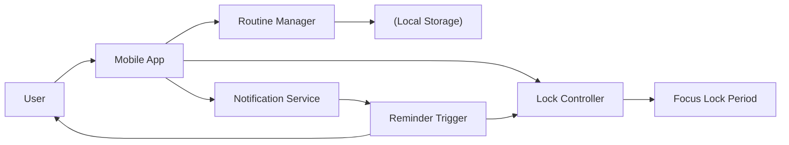
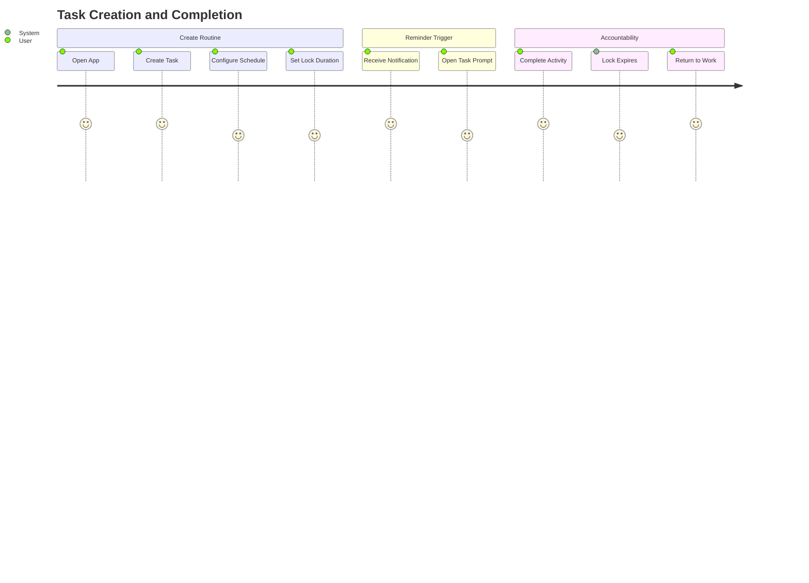

<div align="center">
   
  
# OarBit | Habit & Routine Companion App 


~✦~

`OarBit` is a mobile routine management app designed to help users build healthy habits through scheduled reminders and optional focus-enforcement periods. Unlike traditional reminder apps, `OarBit` can temporarily restrict app usage after a reminder is triggered, encouraging users to complete activities such as stretching, walking, exercising, hydration, language practice, or mindfulness exercises. Developed as part of the **BCDE213 Interactive Media Development** course portfolio, the project explores user-centred design, mobile interaction patterns, and behaviour-driven habit formation.

</div>

## Branch notes: `dev`

**Overview:** Development branch for upcoming features beyond v1.0.0.

**Notes**

The current main release provides task management, timer functionality, and statistics tracking in vanilla JavaScript. Future iterations will explore enhanced reminder scheduling, notification systems, habit-building workflows, optional focus-enforcement mechanics, UI/UX refinements, and architectural improvements as the project evolves.

**Status**: v1.0.0 - Initial Portfolio Release

## Features

- Create custom routines and reminders
- Configure fixed or recurring reminder intervals
- Set reminders for specific times of day
- Optional focus-lock periods after reminders trigger
- Support for short tasks (drink water, vocabulary prompt)
- Support for longer activities (stretching, exercise, walking)
- User-friendly routine management interface
- Customisable reminder schedules and durations

## Architecture at a Glance



## User Journey



## Quick Setup

```bash
# Clone repository
git clone https://github.com/arzen1kos/oarbit-mobile-app.git
cd oarbit-mobile-app

# Install dependencies
npm install

# Start development server
npm run dev
```

## Academic Integrity Notice
>
> This repository was developed solely as a personal academic portfolio project for BCDE213 Interactive Media. All submitted coursework, assessments, design artefacts, and implementation work were completed in accordance with the academic integrity policies and assessment requirements of Ara Institute of Canterbury. This project is provided for portfolio and educational purposes only and should not be submitted, copied, or represented as another student's original work.

---

Created by Arsenie — 2024
